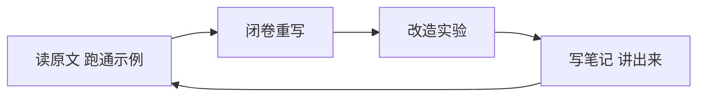

# Agent 学习路线与执行手册

> 面向：以 [datawhalechina/hello-agents](https://github.com/datawhalechina/hello-agents) 为主线的自学
> 定位：从「LLM 使用者」到「Agent 系统构建者」
> 更新日期：2026-10-28

---

## 目录

- [0. 一页速览](#0-一页速览)
- [1. 现状盘点](#1-现状盘点)
- [2. 学习方法：四步闭环](#2-学习方法四步闭环)
- [3. 章节精力分配](#3-章节精力分配)
- [4. 8 周执行计划](#4-8-周执行计划)
- [5. 核心能力清单自测](#5-核心能力清单自测)
- [6. 现有代码的 6 个改造练习](#6-现有代码的-6-个改造练习)
- [7. 评测集模板](#7-评测集模板)
- [8. 可观测性：trace 设计](#8-可观测性trace-设计)
- [9. 论文与资料清单](#9-论文与资料清单)
- [10. 反模式清单](#10-反模式清单)
- [11. 笔记模板](#11-笔记模板)
- [12. 术语速查](#12-术语速查)

---

## 0. 一页速览

**核心结论**

> 读项目 + 手敲代码 = 方向正确，但只覆盖了学习闭环的 1/4。
> 必须补齐：**闭卷重写 → 改造实验 → 量化评估 → 讲得出来**。

**三条铁律**

1. 能对着白板讲明白，才算学会；能改出来，才算掌握。
2. 每个改造都要有指标对比，否则只是瞎试。
3. 收藏 ≠ 学会。读一篇落一条笔记，落不下就是没读懂。

**时间配比建议**

| 活动 | 占比 |
| --- | --- |
| 闭卷重写代码 | 40% |
| 改造 + 对照实验 | 30% |
| 读文档/论文 | 20% |
| 写笔记与复盘 | 10% |

---

## 1. 现状盘点

### 1.1 已完成

| 章节 | 内容 | 产出物 | 状态 |
| --- | --- | --- | --- |
| ch3 | Transformer / LLM 基础 | `hello_agents/temp_class/transformer/my_transformer.py` | 🟡 有 bug 待修 |
| ch4 | ReAct 范式 | `hello_agents/temp_class/simple_temp.py` | 🟡 能跑，缺改造 |
| ch7 | 构建 Agent 框架 | `hello_agents/agents/hello_agents_llm.py` | 🔴 刚起头 |

### 1.2 待办（按优先级）

- [ ] 修完 `my_transformer.py` 的 bug（见 1.3）
- [ ] 补 ch4 的 Plan-and-Solve 与 Reflection
- [ ] 做三范式对照实验
- [ ] 推进 ch7 自研框架（先设计后对照）

### 1.3 `my_transformer.py` 已知 bug

| 位置 | 问题 | 修法 |
| --- | --- | --- |
| `MultiHeadAttention.forward` | `self.W_q(Q)` 用了未定义的大写 `Q` | 改用形参 `query` / `key` / `value` |
| `scaled_dot_product_attention` | `torch.matmul(attn_scores, dim=-1)` 缺第二个参数 | `torch.matmul(attn_probs, V)` |
| `EncoderLayer.__init__` | `MultiHeadAttention()` / `PositionWiseFeedForward()` 未传参数 | 传 `(d_model, num_heads)` / `(d_model, d_ff, dropout)` |
| `DecoderLayer.__init__` | 同上 | 同上 |
| `masked_fill(mask==0, -1e9)` | fp16 下会溢出成 `-inf`，整行被 mask 时得到 NaN | `torch.finfo(scores.dtype).min` |

> 修 bug 的学习效率高于写新代码：它强迫你真正读懂每一行的形状与数据流。

---

## 2. 学习方法：四步闭环



### ① 读 + 跑通

- 原样运行，**不许改一行**。
- 目的：建立一个"正确状态"的参照系，方便后续出问题时定位。

### ② 闭卷重写（最高价值）

- 关掉项目源码，**只保留自己写的注释**，从空文件重写。
- 卡住的地方 = 真正没懂的地方，标记后回去读，再重写。
- 产出：`rewrite/` 目录下的自有版本，用 git 记录，方便 diff。

### ③ 改造实验

在原代码上做**变量实验**，而不是再抄一遍：

| 改造类型 | 示例 |
| --- | --- |
| 换场景 | 旅行助手 → 股票查询助手 / 论文综述助手 |
| 加能力 | 重试与降级、工具超时、相同 `(tool, args)` 去重 |
| 制造故障 | 让工具抛异常，观察 Agent 反应 |
| 对照实验 | 加 few-shot vs 不加，统计 Action 解析失败率 |
| 换范式 | 同一任务用 ReAct / Plan-and-Solve / Reflection 各跑一次 |

### ④ 写笔记 + 讲出来

每个模块配 200 字笔记（见 [第 11 节](#11-笔记模板)）。
最终验收：**能对着白板把机制讲给不懂的人**。

---

## 3. 章节精力分配

教程 16 章价值密度极不均匀，**不要平均用力**。

### Part 1（ch1–3）：快过，2 周封顶

- ch1 / ch2：读一遍，建立概念地图。
- ch3：**别陷进去**。手写 Transformer 对 Agent 开发不是瓶颈。
  - 够用的标准：能说清 `QK^T/√d_k` 为什么缩放、LayerNorm 为什么不用 BatchNorm、位置编码为什么用 sin/cos。
  - 不需要：手推反向传播、啃 attention 各种变体。

### Part 2（ch4–7）：核心区，投入 40%

| 章节 | 要求 | 说明 |
| --- | --- | --- |
| ch4 经典范式 | **必须手写三种** | ReAct / Plan-and-Solve / Reflection，并做对照实验 |
| ch5 低代码平台 | 1–2 天 | 目的是知道能力边界，不是学会用 |
| ch6 框架 | LangGraph 精读 | AutoGen / AgentScope 各跑一个 demo 即可 |
| ch7 自研框架 | **全书最高价值** | 先设计接口再对照官方实现 |

**ch7 两条硬建议**

1. **先设计后对照**：自己先写下 `Agent.run()` / `Tool` / `Memory` 的接口，再读官方实现，用 diff 找差距。顺序反了就变成抄。
2. **只实现用得上的**：每加一层抽象先自问"不加它，上层代码会多几行？"少于 3 行就别加。框架烂掉的根源都是过度抽象。

### Part 3（ch8–12）：按需深挖，投入 30%

| 章节 | 建议 |
| --- | --- |
| ch8 记忆与检索 | 手写一次向量检索 + 分块策略对比，别只调库 |
| ch9 上下文工程 | **重点**。滑窗 / 摘要 / 关键 Observation 保留 |
| ch10 通信协议 MCP | **必须动手**。自写一个 MCP server 给 ReAct 用，简历最值钱 |
| ch11 Agentic-RL | 无 GPU 只做概念理解（SFT → DPO → GRPO 各解决什么） |
| ch12 性能评估 | **不许跳过**。业余与专业的分水岭 |

### Part 4（ch13–15）：选一个做透

旅行助手 / DeepResearch / 赛博小镇，**只选一个**做到能演示。
三个都做 = 三个都不深。

### Part 5（ch16）：用自己项目替掉

毕业设计的价值在于**脱离教程的自由度**。复刻示例仍然是抄。

---

## 4. 8 周执行计划

> 假设每天 2 小时。每周末打勾并写一句复盘。

### 第 1 周：基础收尾

- [ ] 修完 `my_transformer.py` 全部 bug
- [ ] 画一张自己的「Transformer 数据流」图（含所有张量形状）
- [ ] 读完 ch1–ch3，写 1 条概念地图笔记

**验收**：不查资料能讲清 Q/K/V、多头、残差+LN、位置编码各自解决什么问题。

### 第 2 周：三种经典范式

- [ ] 手写 Plan-and-Solve
- [ ] 手写 Reflection
- [ ] 三范式同任务对照实验，填下表

| 范式 | 成功率 | 平均轮数 | 平均 token | 平均耗时 | 主要失败类型 |
| --- | --- | --- | --- | --- | --- |
| ReAct | | | | | |
| Plan-and-Solve | | | | | |
| Reflection | | | | | |

### 第 3 周：平台与框架

- [ ] ch5：Coze 与 Dify 各搭一个 demo
- [ ] ch6：LangGraph 跑通一个带条件边的工作流
- [ ] 写笔记：《什么时候不该用框架》

### 第 4–5 周：自研框架

- [ ] 先独立设计接口（不看官方代码）
- [ ] 实现 `HelloAgentsLLM`（含重试、超时、流式）
- [ ] 实现 `Tool` 注册与参数解析
- [ ] 实现 `Agent` 主循环（对应 ch7）
- [ ] 与官方 HelloAgents 做 diff，记录设计差异

**验收**：框架能跑通「多工具 + 记忆」的最小闭环。

### 第 6 周：记忆与上下文工程

- [ ] 手写向量检索（embedding + cosine 相似度）
- [ ] 对比 2 种分块策略的效果差异
- [ ] 给 ReAct 接入检索
- [ ] 实现上下文滑窗 + 摘要压缩

### 第 7 周：协议与评估

- [ ] 自写一个 MCP server 并接入
- [ ] 建立 20 条评测集（见 [第 7 节](#7-评测集模板)）
- [ ] 跑出基线指标并记录

### 第 8 周：综合案例

- [ ] 从 ch13–15 选一个做透
- [ ] 输出可演示 demo
- [ ] 写评测报告（含失败案例分析）

---

## 5. 核心能力清单自测

每项能独立完成即打勾，**这是判断"学会没有"的客观标准**。

### 基础层

- [ ] 不看代码 30 分钟内写出可运行的 ReAct 循环
- [ ] 解释为什么 Observation 必须回灌上下文
- [ ] 说清 Thought / Action / Observation 三者的角色差异
- [ ] 解释为什么需要 `max_iter` 上限

### 工程层

- [ ] 给 Agent 加「重试 + 降级」机制
- [ ] 设计工具 schema，处理多参数与参数缺失
- [ ] 实现工具超时，避免单次调用挂死整个循环
- [ ] 检测并打断「反复调同一工具、参数不变」的死循环
- [ ] 把全部历史无脑拼接改造成滑窗 / 摘要

### 架构层

- [ ] 从零设计一个 Agent 框架的接口（不参考任何现成实现）
- [ ] 说明何时该用框架、何时该自己写
- [ ] 区分「流程驱动 Agent」与「AI 原生 Agent」的适用场景
- [ ] 自写 MCP server 并让 Agent 调用

### 评估层

- [ ] 建立 10–20 条评测集并计算成功率
- [ ] 定义「失败」的细分类型（格式错 / 选错工具 / 参数错 / 信息不足 / 循环）
- [ ] 用指标判断一次改造是变好还是变坏
- [ ] 能定位一个具体的失败 case 到具体代码行

> 全部打勾 ≈ 达到「能独立交付 Agent 项目」的水平。

---

## 6. 现有代码的 6 个改造练习

针对 `hello_agents/temp_class/simple_temp.py`，按推荐顺序做。

| # | 问题 | 练的能力 | 状态 |
| --- | --- | --- | --- |
| 3 | `get_attraction` 中 `response.get("result")`，Tavily 实际返回键为 `results` | 真实 debug：静默失败 → 空列表 → 看日志定位 | [ ] |
| 6 | 全程 `print`，无结构化 trace | 可观测性（后续所有实验的地基） | [ ] |
| 1 | 历史只增不减，长任务必爆上下文 | ch9 上下文工程 | [ ] |
| 2 | 无相同 `(tool, args)` 去重，可能死循环 | 循环检测与迭代策略 | [ ] |
| 4 | 工具异常被当作答案念给用户 | 错误分类：`tool_error` / `no_data` / `bad_args` | [ ] |
| 5 | 无 few-shot，格式依赖 system prompt 硬约束 | prompt 工程 + A/B 测解析失败率 | [ ] |

**为什么先做 #3 和 #6**

- #3 最快有成就感，且能顺手补上「日志」意识。
- #6 是地基：没有 trace，后面所有对照实验都做不了。

### 参考实现要点

**#1 上下文压缩（伪代码）**

```python
def compress_history(history, max_chars=4000):
    # 保留：首条用户请求 + 最近 N 轮 + 每轮 Action
    # 压缩：过长的 Observation 截断并标注
    ...
```

**#2 循环检测**

```python
seen = set()
key = (tool_name, tuple(sorted(kwargs.items())))
if key in seen:
    observation = "本轮与之前完全相同的调用，请换一种策略或直接 Finish"
else:
    seen.add(key)
    observation = available_tools[tool_name](**kwargs)
```

**#4 错误分类**

```python
class ToolError(Exception):
    kind = "tool_error"      # tool_error | no_data | bad_args
```

把错误类型显式写进 Observation，让模型能区分「该换工具」还是「该换参数」。

---

## 7. 评测集模板

没有评测集的改造都是猜测。建议放在 `eval/cases.json` + `eval/run_eval.py`。

```python
CASES = [
    {
        "id": "c01",
        "question": "北京今天天气怎么样",
        "expect_tools": ["get_weather"],
        "must_contain": ["北京"],
    },
    {
        "id": "c02",
        "question": "北京下雨天适合去哪玩",
        "expect_tools": ["get_weather", "get_attraction"],
    },
    {
        "id": "c03",
        "question": "查一下火星的天气",
        "expect_graceful_failure": True,   # 应优雅失败而非编造
    },
]
```

### 指标定义

| 指标 | 定义 |
| --- | --- |
| 任务成功率 | `must_contain` 全部命中 且 工具序列符合预期的比例 |
| 平均轮数 | 完成任务的平均循环次数（越低越高效） |
| 解析失败率 | `Action` 正则解析失败次数 / 总轮数 |
| 平均 token | 每任务消耗的 prompt+completion token |
| 平均耗时 | 端到端秒数 |
| 失败类型分布 | 格式错 / 选错工具 / 参数错 / 信息不足 / 循环 / 幻觉 |

### 使用方式

1. 改代码前先跑一遍，记录基线。
2. 改完再跑，逐项对比。
3. 只有「成功率不降 + 目标指标改善」才算有效改造。

---

## 8. 可观测性：trace 设计

每一轮至少记录下列字段，输出为 JSON Lines，便于后续统计。

```python
trace = {
    "session_id": "...",
    "round": 1,
    "thought": "...",           # 模型的推理
    "action_raw": "...",        # 原始 Action 字符串
    "tool": "get_weather",
    "args": {"city": "北京"},
    "parse_ok": True,
    "observation": "...",
    "observation_chars": 42,
    "latency_ms": 1830,
    "tokens": {"prompt": 820, "completion": 96},
    "error_kind": None,         # tool_error / no_data / bad_args / format
}
```

**为什么值得单独做**

- 定位失败 case 时，日志是唯一证据。
- 指标统计直接从 trace 聚合，不用重新跑。
- 后续做「同一 (tool, args) 去重」「上下文压缩」都需要历史轨迹。

---

## 9. 论文与资料清单

每篇 1 小时，**只在对应章节读**，不要贪多。

| 对应章节 | 资料 | 关注点 |
| --- | --- | --- |
| ch4 | ReAct (2022) | Thought-Action-Observation 交替的收益来源 |
| ch4 | Reflexion (2023) | 自我批判 + 记忆，如何形成改进闭环 |
| ch4 | Plan-and-Solve (2023) | 先规划后执行的适用条件 |
| ch6/7 | ReWOO (2023) | 规划与执行分离，减少无效调用 |
| ch7 | LLM Compiler | 并行化与 DAG 化执行 |
| ch8 | RAG 原始论文 | 检索增强的基本链路 |
| ch8 | Lost in the Middle | 上下文位置对利用率的影响 |
| ch9 | Building Effective Agents（Anthropic） | 什么场景不该上 Agent |
| ch12 | SWE-bench / AgentBench | 「成功」如何定义与度量 |

---

## 10. 反模式清单

- ❌ **收藏文章**：收藏即学会是最大的错觉。
- ❌ **一开始读框架源码**：LangChain / LangGraph 几十万行，投入产出比极低。
- ❌ **陷进 RL / 数学推导**：目标是构建者，不是训练算法研究员。
- ❌ **只跑 demo 不做评估**：无法判断改动好坏。
- ❌ **同时学 3 个方向**：Agent / 微调 / 推理优化，先做完一条线。
- ❌ **过度抽象**：框架里加一层抽象省不下 3 行代码，就是负债。
- ❌ **抄写式学习**：看着屏幕誊写，会制造虚假熟悉感。
- ❌ **忽视错误处理**：玩具 demo 与生产系统的差距 90% 在异常路径。

---

## 11. 笔记模板

每个模块（或每章）建一个 md，控制在 200–400 字。

```markdown
# <模块名>

## 它解决什么问题
（一句话）

## 核心机制
（一句话 + 一张图或伪代码）

## 关键取舍
（为什么这样设计，替代方案是什么）

## 我踩的坑
- 

## 如果重做，我会怎么改
- 
```

**写不出「关键取舍」= 还没读懂**，回头重读。

---

## 12. 术语速查

| 术语 | 一句话解释 |
| --- | --- |
| Agent | 由 LLM 驱动、可调用工具、能根据反馈迭代行动的自主系统 |
| ReAct | Reasoning + Acting，Thought 与 Action 交替，Observation 回灌 |
| Plan-and-Solve | 先产出完整计划，再逐步执行 |
| Reflection | 生成 → 自我批判 → 重写 的二次循环 |
| CoT | 思维链，只在脑内推理，不接触外部工具 |
| Tool Calling | 模型输出结构化工具调用，由运行时执行 |
| MCP | Model Context Protocol，模型与外部能力的标准化接口 |
| RAG | 检索增强生成，先查再答 |
| Context Engineering | 决定「什么进上下文、以什么形式进、何时丢弃」 |
| Trace | 一次任务执行的结构化轨迹记录 |
| Golden Set | 人工标注的评测集，用于回归测试 |
| Pre-LN / Post-LN | LayerNorm 放在子层前 / 后，前者更易训练 |

---

## 附：每周末三问

1. 这周我**闭卷**写出了什么？
2. 这周哪个改造**有指标对比**？
3. 这周我能**讲清**什么之前讲不清的东西？

三个都答不上来，说明这周在「输入」而非「学习」。
